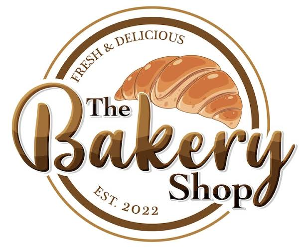

# The Bakery Shop — Sales Dashboard

A mobile-friendly dashboard that shows how sales are going at **The Bakery Shop** — total sales, orders, best sellers and busiest hours — with large buttons and icons that are easy to tap on a phone. It shows the shop's logo large in the header and uses a palette taken from it: browns and croissant gold, with fresh green as the main accent color.

> **Version 1 uses sample data.** The numbers are generated in the browser and are not real sales.

## Features

- **Home:** total sales with a comparison to the previous period, plus orders, items sold, average order and peak hour.
- **Time periods:** Today, Last 7 days and Last 30 days.
- **Sales-by-hour / by-day chart:** tap or drag across the bars to read a value; "View as table" shows the same numbers as text.
- **Best sellers:** the top 5 products; tap one to jump to it in Items.
- **Sales by category:** donut chart; tap a category to filter the whole dashboard.
- **Sales tab:** switch the chart between revenue, orders and items; payment methods (card, cash, mobile pay); daily totals.
- **Items tab:** search products, filter by category, see units sold and stock left with a low-stock warning.
- **More tab:** export the current view as CSV, share today's summary, dark mode.
- **Responsive:** bottom navigation on phones, side navigation on desktop; every tap target is at least 68 px, with large icons.

## How to view it

It is plain HTML, CSS and JavaScript with no build step.

- **Locally:** serve the folder with any static web server and open `index.html`, for example `python -m http.server` then visit `http://localhost:8000`.
- **GitHub Pages:** the files are ready to be published straight from the `main` branch.

## Project files

| File | What it is |
|------|-----------|
| `index.html` | The page and icon set |
| `css/styles.css` | Colors, layout and responsive rules |
| `js/data.js` | Sample sales data |
| `js/app.js` | The dashboard screens and interactions |
| `assets/logo.jpg` | The shop logo |
| `spec.md` | The full design specification |
| `practice.md` | How we work on this project |
