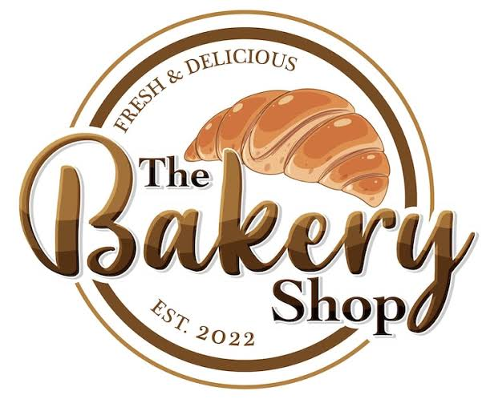

# The Bakery Shop — Sales Dashboard Spec



## 1. Purpose

A mobile-first dashboard that lets the owner and staff of **The Bakery Shop** (est. 2022, "Fresh & Delicious") see how sales are doing at a glance — from a phone, behind the counter or at the market stall, with floury fingers.

**Primary questions it answers in under 5 seconds:**
1. How much have we sold today?
2. What is selling best (and what is left over)?
3. When are our busiest hours?
4. How does this compare to yesterday / last week?

## 2. Requirements (from the brief)

| # | Requirement | How this spec meets it |
|---|-------------|------------------------|
| 1 | **Mobile friendly** | Mobile-first single-column layout designed for 360–430 px wide screens, scaling up to tablet/desktop (§5). No hover-only interactions, no horizontal scrolling, bottom navigation within thumb reach. |
| 2 | **Large buttons and icons** | Minimum 68 × 68 px touch targets (primary buttons 80 px), 40–56 px icons, big labels (§6). |
| 3 | **Use the logo and complementary colors** | A large logo in the header, and a palette built from the logo's browns and gold plus a fresh green accent and a blue secondary (§3, §4). |

## 3. Branding

### 3.1 Logo usage
- File: `assets/logo.jpg` (circular badge: croissant, script "Bakery", "The" / "Shop", "Fresh & Delicious", "Est. 2022").
- **Header:** logo shown large, at **88 px height** (mobile) / **120 px** (tablet+), left-aligned, always linked to the Home screen. The header has a 5 px Leaf Green edge along its bottom.
- **About screen:** logo at 200 px wide.
- **Splash / loading screen:** logo centered at 160 px on cream background with a subtle pulse while data loads.
- **Empty states and the "Closed for today" screen:** logo at 96 px above the message.
- Keep clear space around the logo equal to the height of the "T" in "The". Never stretch, recolor, or place on a busy background. The JPG has a white background, so it sits on a **white header bar**; request a transparent PNG/SVG from the owner for use on colored backgrounds.
- Browser tab / home-screen icon: crop to the croissant.

### 3.2 Color palette (sampled from the logo, plus green and a blue complement)

The logo is built from warm browns and a golden-orange croissant (hue ≈ 25–35°).

- **Green is the main accent.** A fresh leaf green (hue ≈ 140°) reads as natural and bakery-fresh, and sits well beside the warm browns. It is used for everything interactive: primary and selected buttons, the active navigation item, KPI icon circles, chart bars, the header edge and the outer ring of the hero card.
- **Blue is the secondary accent.** The wheel complement of the logo's orange is a blue (hue ≈ 200–215°), kept for the "Drinks" category and other secondary highlights.
- **Gold stays the brand highlight** (hero card border, nav indicator, "Pastries").

| Role | Name | Hex | Used for |
|------|------|-----|----------|
| Brand dark | Espresso | `#4A2E14` | Headings, body text, icons on light backgrounds |
| Brand mid | Caramel | `#A9702F` | Secondary text, borders, chart series 2 |
| Brand primary | Croissant Gold | `#D98B3A` | Hero card border, nav indicator, "Pastries" category |
| Brand light | Butter | `#F0B66B` | Hero card total, hover/pressed tints |
| Surface | Cream | `#FFF6E8` | Page background |
| Surface raised | White | `#FFFFFF` | Cards, header bar (matches logo background) |
| **Main accent** | **Leaf Green** | `#2E7D46` | Primary and selected buttons, active nav item, KPI icons, selected chart bar, header edge, section markers, links |
| Accent tint | Mint | `#DDEFE0` | Accent backgrounds: icon circles, chart readout, filter pill, refresh button |
| Chart bars | Fresh Green | `#5BAA6E` | Unselected chart bars |
| Secondary accent | Blueberry | `#2B6A83` | "Drinks" category, secondary highlights |
| Secondary tint | Blueberry Mist | `#DCEBF1` | Secondary backgrounds |
| Positive | Sage | `#3E7C4F` | "Up vs. last period" |
| Negative | Berry | `#B03A48` | "Down vs. last period", low stock |

**Contrast rules (WCAG AA):**
- Espresso on Cream ≈ 11:1 ✔ · White on Leaf Green ≈ 5:1 ✔ · White on Blueberry ≈ 6:1 ✔ · Espresso on Croissant Gold ≈ 4.5:1 ✔ (use bold/large text only).
- Leaf Green on Mint and on White is used for large or bold text and icons only.
- White text on Caramel or Gold is **not** allowed (below 4.5:1).
- Never use color alone to convey up/down: always pair with an arrow icon (▲ / ▼) and a +/− sign.

### 3.3 Typography
- **Display / screen titles:** a friendly script such as *Pacifico* or *Lobster* (echoes the "Bakery" lettering). Use sparingly — titles and the big hero number only.
- **Numbers and body:** a rounded sans such as *Nunito* (tabular figures for money).
- Base size **18 px** (larger than usual for readability); KPI numbers **36–44 px**, bold.

## 4. Visual style
- Rounded corners: 20 px on cards, 34–40 px on buttons (pill-like, echoing the circular logo).
- Soft shadow (`0 4px 12px rgba(74,46,20,.12)`); no thin hairline borders.
- Generous spacing: 16 px page gutters, 16 px between cards.
- Decorative touch: a double ring (Gold border + Leaf Green outer ring) around the hero card, inspired by the logo's circle. Card and section titles get a small Leaf Green marker bar.
- Icons: a single filled, rounded icon set (e.g. Material Symbols Rounded or Phosphor Fill), 2 px stroke weight when outlined, Espresso or Leaf Green only.

## 5. Layout and responsiveness

**Mobile-first**, three breakpoints:

| Breakpoint | Width | Layout |
|-----------|-------|--------|
| Phone | < 600 px | 1 column; KPI cards in a 2 × 2 grid; bottom navigation bar |
| Tablet | 600–1023 px | 2 columns for charts/lists; bottom nav stays |
| Desktop | ≥ 1024 px | 12-column grid, left side-rail navigation replaces bottom nav, max content width 1200 px |

Rules:
- No horizontal scroll at 320 px width.
- Portrait and landscape both supported.
- Respect safe-area insets (notches, home indicator).
- Works one-handed: primary actions and navigation in the **bottom 40 %** of the screen.
- Fast on cheap phones/3G: first meaningful paint < 2 s, total JS < 200 KB gzipped, skeleton loaders instead of spinners.

### 5.1 Wireframe — phone (portrait)

```
┌──────────────────────────────┐
│ [ LOGO ] Sales Dashboard   ⟳ │  ← white header, logo 88px, green edge, refresh button
├━━━━━━━━━━━━━━━━━━━━━━━━━━━━━━┤
│ [ Today ][ Week ][ Month ]   │  ← big segmented buttons (68px)
├──────────────────────────────┤
│  ╔════════════════════════╗  │
│  ║  💰 TOTAL SALES        ║  │  ← hero card (double ring)
│  ║  $1,284.50             ║  │
│  ║  ▲ 12% vs yesterday    ║  │
│  ╚════════════════════════╝  │
│ ┌────────────┐ ┌───────────┐ │
│ │ 🧾 Orders  │ │ 🥐 Items  │ │  ← KPI cards, 2×2
│ │    142     │ │    389    │ │
│ └────────────┘ └───────────┘ │
│ ┌────────────┐ ┌───────────┐ │
│ │ 👛 Avg.    │ │ ⏰ Peak   │ │
│ │   $9.05    │ │ 8–9 AM    │ │
│ └────────────┘ └───────────┘ │
│  Sales by hour                │
│  ▂▃▇█▆▄▃▂▂▃▄▃  (bar chart)   │
│  Best sellers                 │
│  1 🥐 Butter croissant   86   │
│  2 🍞 Sourdough loaf     54   │
│  3 🧁 Cupcake            41   │
│        [ See all ▸ ]          │
├──────────────────────────────┤
│ 🏠Home  📈Sales  🥖Items  ⚙️More│  ← bottom nav, 80px tall
└──────────────────────────────┘
```

## 6. Large buttons and icons

| Element | Minimum size | Notes |
|---------|-------------|-------|
| Any tappable target | **68 × 68 px** (56 px absolute floor on desktop mouse) | At least 12 px spacing between adjacent targets |
| Primary buttons | **80 px** tall, full-width on phone, Leaf Green background, white 22 px bold label | Icon (28 px) to the left of label |
| Segmented period buttons | 68 px tall, equal width, 20 px label; selected = Leaf Green fill + white text; unselected = white + Espresso text | |
| Bottom navigation items | 80 px tall, icon **40 px** + 15 px label, always show labels | Active item: Leaf Green icon + Gold indicator bar |
| KPI card icons | **40 px**, inside an 84 px Mint circle, Leaf Green icon | |
| List row icons | 52 px | Whole row is tappable (min 76 px tall) |
| Icon-only buttons (refresh, calendar) | 68 px hit area, 36 px icon, with `aria-label` | |
| Category and filter buttons | 68 px tall, 26 px color dot | |

Interaction feedback: pressed state darkens fill 10 % and scales to 0.97; haptic tick on mobile where supported.

## 7. Screens and content

### 7.1 Home (default)
1. **Header** — large logo, title, current date, "Sample data" label (until real data is connected), refresh button (the last-updated time is in its accessible label).
2. **Period selector** — *Today · This Week · This Month · Custom* (Custom opens a large calendar sheet with big day cells, ≥ 48 px).
3. **Hero card — Total Sales** for the period, comparison vs. previous period with ▲/▼ and %.
4. **KPI cards (2 × 2)** — each with a 40 px icon in an 84 px circle, label, value:
   - 🧾 **Orders** (count)
   - 🥐 **Items sold** (count)
   - 👛 **Average order** (currency)
   - ⏰ **Peak hour** (time range)
5. **Sales by hour** (Today) / **by day** (Week/Month) — bar chart, green bars, the selected (initially the peak) bar in Leaf Green, 220 px tall, tap a bar to see a tooltip sheet with exact value.
6. **Best sellers** — top 5 products with icon, name, units, revenue; "See all" button.
7. **Category split** — donut chart (Breads, Pastries, Cakes, Cookies, Drinks) with large legend buttons that filter the dashboard when tapped.

### 7.2 Sales
- Trend line/bars for the selected period; toggle **Revenue / Orders / Items** (large segmented buttons).
- Table → card list of daily totals (one card per day).
- Payment method breakdown (💳 Card, 💵 Cash, 📱 Mobile pay).

### 7.3 Items
- Searchable list of products (search field 72 px tall, sticky below the header).
- Category chips (large, horizontally scrollable, snap scrolling).
- Per product: icon, units sold, revenue, **stock left** (Berry "Low stock" badge when ≤ 5 units).

### 7.4 More
- Export CSV/PDF (primary button), Share today's summary (native share sheet), Date range, Language, Light/Dark toggle, About (logo + "Est. 2022").

## 8. Data model

```text
Sale        { id, timestamp, total, paymentMethod, items[] }
SaleItem    { productId, quantity, unitPrice }
Product     { id, name, category, icon, price, stock }
Category    { id, name, icon }          // Breads, Pastries, Cakes, Cookies, Drinks
```

Derived metrics (computed per selected period, compared with the immediately preceding period of equal length):
- `totalSales = Σ sale.total`
- `orders = count(sales)`
- `itemsSold = Σ quantity`
- `avgOrder = totalSales / orders`
- `peakHour = hour with the highest totalSales`
- `delta% = (current − previous) / previous × 100` (show "—" if previous = 0)

### Sample data for prototyping
| Product | Category | Price | Units today |
|---------|----------|-------|------------|
| Butter croissant | Pastries | $3.50 | 86 |
| Sourdough loaf | Breads | $7.00 | 54 |
| Chocolate cupcake | Cakes | $3.00 | 41 |
| Cinnamon roll | Pastries | $4.00 | 38 |
| Baguette | Breads | $3.25 | 35 |
| Oat cookie | Cookies | $2.00 | 33 |
| Latte | Drinks | $4.50 | 29 |

## 9. Behavior

- **Data source:** start with a JSON file / mock API (`/api/sales?from=&to=`); design so a POS or spreadsheet export can be plugged in later.
- **Refresh:** auto-refresh every 60 s while the app is visible; manual refresh button; pull-to-refresh on mobile.
- **Loading:** skeleton cards in the same positions; never a blank screen.
- **Empty state:** logo + "No sales yet today — the ovens are warming up! 🥐".
- **Error / offline:** friendly banner "Can't reach the shop data. Showing last saved numbers (hh:mm)" with a large **Try again** button; last data cached locally.
- **Currency/locale:** configurable; defaults to the device locale. Dates in the shop's timezone.
- **Persistence:** remember the last selected period and tab.

## 10. Accessibility
- WCAG 2.1 AA contrast (see §3.2).
- All icons have text labels or `aria-label`; charts have a text summary ("Peak: 8–9 AM, $214") and a "View as table" toggle.
- Focus rings: 3 px Leaf Green outline, visible on keyboard navigation.
- Respect `prefers-reduced-motion` and `prefers-color-scheme`. Dark mode: Espresso background (`#2A1A0C`), Cream text, and the green accent lightened to `#8FD3A1` (dark text on it) to keep contrast.
- Supports browser text zoom to 200 % without breaking layout.

## 11. Suggested tech (non-binding)
- Single-page web app (PWA, installable on the home screen), HTML/CSS/JS or React + Vite.
- Tailwind CSS or CSS variables for the tokens in §3.2 (`--espresso`, `--caramel`, `--gold`, `--butter`, `--cream`, `--leaf`, `--mint`, `--blueberry`, `--mist`), plus `--tap: 68px` for the minimum tap target.
- Charts: Chart.js or lightweight SVG charts, themed with the palette.
- Hosting: any static host; no login required for v1 (add PIN protection in v2).

## 12. Acceptance criteria

- [ ] Logo appears in the header on every screen and on the loading screen, unstretched.
- [ ] Only palette colors from §3.2 are used; no text fails AA contrast.
- [ ] Every tappable control is at least 68 × 68 px on phone (verified with devtools at 360 × 740 and 390 × 844).
- [ ] The header logo is at least 88 px tall on phone and 120 px on tablet/desktop.
- [ ] Navigation icons are 40 px and KPI icons 40 px (in 84 px circles), all labeled.
- [ ] Green (Leaf Green and Mint) is the dominant accent on buttons, navigation, icons and charts.
- [ ] No horizontal scrolling from 320 px up to 1440 px width.
- [ ] Home screen shows total sales, orders, items, average order, hourly chart and top 5 products without scrolling past two screen heights on a phone.
- [ ] Switching Today / Week / Month updates all widgets in < 300 ms (with local data).
- [ ] Works offline with last-known data and clearly says so.
- [ ] Lighthouse mobile score ≥ 90 for Performance and Accessibility.

## 13. Out of scope (v1)
- Taking orders / POS functionality.
- Multi-store comparison.
- User accounts and roles.
- Inventory ordering and supplier management.

## 14. Open questions
1. Where does the sales data come from today (POS system, spreadsheet, manual entry)?
2. Can we get the logo as a transparent PNG/SVG?
3. Single shop or multiple locations?
4. Which currency and language(s) should be supported?
5. Who will view this — owner only, or all staff?

## 15. Revision history

| Version | Date | Changes |
|---------|------|---------|
| 1.0 | 2026-11-24 | First spec and first working version (sample data). |
| 1.1 | 2026-11-24 | **Larger buttons:** minimum tap target 56 → 68 px, primary buttons 64 → 80 px, bottom navigation 64 → 80 px with 40 px icons. **Larger logo:** header logo 56 → 88 px (phone) and 72 → 120 px (tablet+). **More green:** Leaf Green replaces blue as the main accent (buttons, navigation, icons, charts, header edge, hero ring); blue kept as a secondary accent. |
